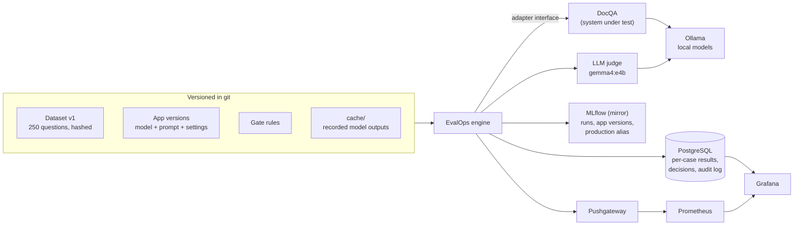

# EvalOps: Evaluation and Release Gating for LLM Applications

[](https://github.com/Jaswant06/evalops/actions/workflows/ci.yml)


**EvalOps decides whether a new version of an AI application is allowed to ship.**

Changing an LLM application's model, prompt or settings can quietly make it
worse: it starts inventing facts, stops citing its sources, or answers
questions it should decline. EvalOps tests every candidate version on a fixed,
versioned set of questions, compares it with the version in production on
exactly the same questions, and blocks the release if it breaks any rule the
team agreed on. The check runs on every pull request, so a regression cannot be
merged.

The repository comes with a complete example: DocQA, a small assistant that
answers questions about company policy documents, taken through six versions.
A deliberately degraded version (a smaller, faster, less accurate model) is
blocked and cannot be promoted, and you can watch that happen on your own
machine in a few minutes, without a GPU or any API key:
[Try it in five minutes](#try-it-in-five-minutes).

**Contents**

- Start here: [What it does, in simple words](#what-it-does-in-simple-words), [Try it in five minutes](#try-it-in-five-minutes), [Results](#results)
- How it works: [Pipeline](#how-it-works), [What gets measured](#what-gets-measured), [Run modes](#run-modes-replay-live-rescore-auto), [Release: gate, promote, rollback](#release-gate-promote-rollback), [Versioning](#versioning-and-reproducibility)
- Proof: [CI on every pull request](#ci-required-checks-on-every-pull-request), [Reliability](#reliability-tested-on-a-schedule-not-on-every-pull-request), [Can the judge be trusted?](#can-the-judge-be-trusted)
- Going further: [Live models and the full stack](#running-it-with-live-models-and-the-full-stack), [Evaluating your own change](#evaluating-your-own-change), [Command reference](#command-reference), [Limitations](#limitations)

## What it does, in simple words

Picture an assistant that answers employees' questions about a company policy.
Someone wants to change it: a newer model, a reworded prompt, a different
setting. Will the change make it better or worse? Trying a few questions by
hand will not tell you. EvalOps answers that question the way a careful team
would, and the same way every time:

1. **A fixed exam.** 250 questions about policy documents, each with a correct
   answer written by a person. Forty of them cannot be answered from the
   document, and the right response to those is "the document does not say".
   Once published, the questions never change: a fingerprint catches any edit.
2. **Both versions sit the same exam.** The new version (the *candidate*) and
   the version live today (*production*) answer exactly the same questions.
3. **Marking.** Whatever code can check, code checks: is the answer well
   formed, do its citations point to real passages, did it decline when it
   should have. What needs understanding (is the answer correct, is every claim
   backed by the document) is marked by a second AI model, the *judge*.
4. **A verdict against rules agreed in advance.** For example: correctness may
   not drop by more than 3 points, at most 3% of claims may be unsupported, and
   95% of answers must arrive within 4 seconds. Breaking any required rule
   blocks the release, and the report lists the questions that got worse, with
   both versions' answers.
5. **Only a passing verdict can ship.** Promotion is a separate step that
   accepts only a recent, passing verdict for exactly that version. Every
   verdict, promotion, refusal and rollback goes into an audit log.

On GitHub, this check runs on every pull request, and a version that fails it
cannot be merged.

**Words used in this README**

| Word | Meaning |
|---|---|
| app version | one YAML file in `configs/apps/` that fixes everything about a version: the model and its exact build, the prompt, the settings |
| production | the version that is live now, recorded in `configs/release.yaml` |
| candidate | a version you would like to release |
| `gate` | evaluate a candidate against production and record a verdict; it never changes production |
| `promote` | make a candidate production; allowed only with a passing verdict |
| `rollback` | put an earlier approved version back into production, with a written reason |
| replay | reuse recorded model answers instead of calling the model: the same numbers, in seconds, with no GPU |
| live | call the models now (needs [Ollama](https://ollama.com)) |
| judge | the AI model that marks answers for correctness and grounding (`gemma4:e4b`) |

## Try it in five minutes

No GPU, no Docker, no API keys: the answers of every version and the judge's
marks are recorded in `cache/`, and everything below replays them. You need
Python 3.11 or newer and git.

**1. Install.**

```bash
git clone https://github.com/Jaswant06/evalops.git
cd evalops
python3 -m venv .venv
source .venv/bin/activate          # on Windows: .venv\Scripts\activate
pip install -e ".[dev]"
```

**2. Check that everything is in order.**

```bash
pytest -q
evalops validate
```

You should see `104 passed, 2 skipped`, then `ok` on every line of the
validation, ending with the dataset: `policies/v1: ok (hash a7fc1827c5e9)`.

**3. Evaluate the version in production.**

```bash
evalops run configs/apps/docqa-v1.2.yaml --mode replay
```

It takes about a second: the 250 recorded answers are marked again by the
current code, and the headline numbers are printed, each with where it comes
from (`judged` by the judge model, `deterministic` from code, `measured`, or
`estimated`):

```text
docqa 1.2.0 on policies/v1:test: completed
  answer_correctness           answerable             85.0%  judged
  correct_abstention_rate      unanswerable           82.5%  deterministic
  citation_support_rate        citation_required      99.5%  judged
  unsupported_claim_rate       all                     0.2%  judged
  app_failure_rate             all                     0.0%  deterministic
  latency_p95_s                all                   2.34 s  measured  (recorded, not measured now)
  est_cost_per_success_usd     all                $0.000050  estimated
```

The full report, with every metric for every category, is written to
`.evalops/runs/<run id>/report.md`.

**4. Try to release a deliberately degraded version.** DocQA 2.0 swaps the 4B
model for a 0.8B one: 2.4 times faster, and noticeably worse.

```bash
evalops gate configs/apps/docqa-v2.0.yaml --mode replay
evalops promote configs/apps/docqa-v2.0.yaml
```

```text
Release decision: BLOCKED
  Candidate:   docqa 2.0.0            run docqa-v2.0.0-20261011T043320-afce
  Production:  docqa 1.2.0            run docqa-v1.2.0-20261011T043319-7be3

Answer quality
  answer-correctness      answerable             85.0% -> 73.8%       -11.2 pts   FAIL
Abstention
  no-false-abstentions    answerable              4.3% -> 9.0%         +4.8 pts   FAIL
  declines-unanswerable   unanswerable           82.5% -> 60.0%       -22.5 pts   FAIL
(the other eleven rules, from citations to latency, are listed too)

Reasons
  - answer-correctness [answerable]: 73.8% is below the minimum 80.0%; dropped -11.2 pts vs production (allowed: -3.0 pts)
      e.g. afhcvbzz-q3: verdict correct -> incorrect
  - declines-unanswerable [unanswerable]: 60.0% is below the minimum 75.0%; dropped -22.5 pts vs production (allowed: -7.5 pts)
      e.g. afhcvbzz-q5: answered a question the document cannot answer

Promotion: BLOCKED. Production is unchanged.

Promotion: REFUSED. Not promoted: production is unchanged.
  - the gate decision gate-20261011T043320-c3da84 is BLOCKED; a failed evaluation never changes production
```

Both commands exit with code 1, which is what fails the check in CI. (Run ids
and times will differ on your machine.)

**5. Watch a good version get released.** Production is already 1.2, the end
of the release history. To replay that history, roll back to 1.0, then gate
the two candidates that came after it:

```bash
evalops rollback --reason "replay the release history"
evalops gate configs/apps/docqa-v1.1.yaml --mode replay    # BLOCKED
evalops gate configs/apps/docqa-v1.2.yaml --mode replay    # PASS
evalops promote configs/apps/docqa-v1.2.yaml               # DONE: production is 1.2.0 again
```

1.1 is the instructive one. Its prompt asked for "more helpful" answers, and it
*is* more accurate than 1.0 (84.0% to 88.3% correct), yet it is blocked: it
cites passages that do not support what it says, adds claims the document
never makes, and answers questions it should decline. 1.2 keeps the friendlier
style but requires a citation for every fact, and passes. The
[full comparison report](docs/decision-docqa-1.1.md) shows every affected
question with both answers.

**6. Look at the record.**

```bash
evalops audit         # every verdict, promotion, refusal and rollback
evalops runs          # the evaluations you just ran
evalops serve         # the API: open http://127.0.0.1:8000/docs, stop with Ctrl+C
```

```text
2026-10-11 04:33:20  gate_decision      docqa 2.0.0            gate-20261011T043320-c3da84      Jaswant              fail
2026-10-11 04:33:21  promotion_refused  docqa 2.0.0            gate-20261011T043320-c3da84      Jaswant              the gate decision gate-20261011T043320-c3da84 is BLOCKED; a failed evaluation never changes production
2026-10-11 04:33:28  rollback           docqa 1.0.0            gate-20261011T034831-39f127      Jaswant              from 1.2.0: replay the release history
2026-10-11 04:33:29  gate_decision      docqa 1.1.0            gate-20261011T043329-43cf59      Jaswant              fail
2026-10-11 04:33:30  gate_decision      docqa 1.2.0            gate-20261011T043330-450a40      Jaswant              pass
2026-10-11 04:33:35  promoted           docqa 1.2.0            gate-20261011T043330-450a40      Jaswant
```

**7. Optional: break things on purpose.**

```bash
python scripts/failure_drills.py
```

Nine failures (wrong answers, citations that do not support the answer,
timeouts, malformed output, a correct but slow version, an edited dataset, an
interrupted run, a database outage, changed model weights) and one valid
control are staged in a throwaway copy of the repository, in about ten
seconds. Each must end with the right exit code and production untouched; the
last line should read `10/10 drills behaved as expected.`

**Start over.** The walkthrough rewrote `configs/release.yaml` (rollback, then
promotion) and saved results to `evalops.db` and `.evalops/`, which git
ignores. To reset:

```bash
git checkout configs/release.yaml
rm -rf evalops.db .evalops
```

**Exit codes**, here and in CI: `0` passed or done; `1` blocked or refused; `2`
the evaluation itself could not produce a valid result (an edited dataset, a
missing recording, a database outage), which never counts as a pass.

## Results

DocQA, a small policy-document assistant running on local models,
was put through six versions on 250 questions (210 answerable, 40 the document
cannot answer). A prompt change that made answers "more helpful" raised
correctness from 84.0% to 88.3%, a real gain (95% interval +1.9 to +6.9 points),
and EvalOps still blocked it: citation support fell from 99.8% to 82.3%,
unsupported claims rose from 0.2% to 9.8%, it answered 5 more questions it
should have declined, and p95 latency nearly tripled. The fixed prompt (1.2)
passed and was promoted. A 9B model was more accurate but blocked on latency
alone, and a 0.8B model was 2.4 times faster and blocked for being wrong.

| Version | What changed | Correct answers | Declines unanswerable | Citation support | Unsupported claims | App failures | p95 latency | Est. cost per success | Release gate |
|---|---|---|---|---|---|---|---|---|---|
| 1.0.0 | production baseline: qwen3.5:4b, grounded prompt | 84.0% | 82.5% | 99.8% | 0.2% | 0.0% | 2.34 s | $0.000050 | **PASS** (first release) |
| 1.1.0 | prompt: "more helpful", adds practical context | 88.3% | 70.0% | 82.3% | 9.8% | 0.0% | 6.81 s | $0.000070 | **BLOCKED** vs 1.0.0: declines-unanswerable, citation-support, unsupported-claims, latency-p95 |
| 1.2.0 | fix: helpful style, document-only, cite every fact | 85.0% | 82.5% | 99.5% | 0.2% | 0.0% | 2.34 s | $0.000050 | **PASS** vs 1.0.0 |
| 1.3.0 | bigger model: qwen3.5:9b | 86.9% | 80.0% | 98.6% | 0.0% | 0.0% | 4.55 s | $0.000083 | **BLOCKED** vs 1.2.0: latency-p95 |
| 2.0.0 | deliberately degraded: qwen3.5:0.8b | 73.8% | 60.0% | 97.6% | 0.7% | 0.0% | 0.99 s | $0.000021 | **BLOCKED** vs 1.2.0: answer-correctness, no-false-abstentions, declines-unanswerable |
| 1.0.0+faults | 1.0 with 5% timeouts and 2% malformed output injected | 77.9% | 72.5% | 99.7% | 0.0% | 8.4% | 2.36 s | $0.000052 | **BLOCKED** vs 1.2.0: answer-correctness, declines-unanswerable, app-failures |

Each version was evaluated once on the test split and gated against production
at the time (1.0, then 1.2). Every number above is replayable: `evalops run
<config> --mode replay` recomputes it from the recorded outputs in seconds.
Latency was measured on one laptop (Apple M5) and cost uses illustrative rates;
see [Limitations](#limitations).

**Under load.** The evaluation measures one request at a time; `evalops loadtest`
sends real test questions to the running DocQA service (production 1.2), 30 per
level:

| Concurrent requests | Throughput | p50 latency | p95 latency | Errors |
|---|---|---|---|---|
| 1 | 0.58 req/s | 1.76 s | 2.74 s | 0 |
| 2 | 0.62 req/s | 3.14 s | 4.70 s | 0 |
| 4 | 0.64 req/s | 6.27 s | 8.28 s | 0 |

Throughput barely moves while latency grows with the number of concurrent
requests: this local Ollama setup answers one request at a time, so extra users
queue. Serving more of them would need parallel model slots or more replicas,
and the 4-second latency budget in the gate only holds at low concurrency.

## How it works

In technical terms, EvalOps is an evaluation engine and release pipeline for LLM
applications: versioned JSONL datasets with hash verification, an adapter
interface that keeps the engine independent of the application under test,
deterministic checks kept separate from an LLM judge, version-aware caching of
model outputs, category-aware release gates with paired bootstrap confidence
intervals, a gate / promote / rollback workflow with an audit log, and CI that
replays recorded outputs in GitHub Actions. PostgreSQL holds the per-case
results and every decision, MLflow mirrors experiments and app versions,
Prometheus collects operational metrics, and Grafana shows production against
the candidate. Failure handling is tested on purpose: ten failure drills and
real-process reliability tests, including stopping the database mid-run.



Every evaluation runs the same ten steps:

1. **Load the dataset** version and verify every file against its manifest hash.
2. **Validate the configuration**: app version, scoring, gate rules and pricing are
   parsed by strict schemas (an unknown key or a gate rule naming a metric that
   does not exist stops the run).
3. **Initialize the run**: fingerprint every input and record the run as `running`.
4. **Execute the test cases** through the application's adapter, as the run mode
   says: recorded outputs, live inference, or recorded where they exist.
5. **Capture responses**: answer, citations, retrieved passages, tokens, latency,
   status. Each one is written to the database as soon as it exists.
6. **Deterministic checks**: everything a parser or a set lookup can decide.
7. **LLM judge**: only for the semantic questions.
8. **Metrics**, overall and per category.
9. **Persist** to PostgreSQL and MLflow; push operational metrics.
10. **Report**, and only then mark the run `completed`. Anything that stops a run
    earlier leaves it `failed` (with the reason's class) or `interrupted`, and the
    gate refuses it.

### EvalOps is independent of the application

The engine never imports DocQA. An app version is a YAML file that names an
adapter class; the adapter turns a test case into a standard `AppResponse`
(answer, abstained, citations, retrieved passages, token usage, latency,
status). Evaluating another RAG system or a prediction API means writing one
adapter. The test suite proves it by evaluating a second, scripted application
through the same interface.

```python
class AppAdapter(ABC):
    output_model: ClassVar[type[BaseModel] | None]          # parsed by the evaluator, not trusted
    def components(self) -> dict: ...                       # model + digest, prompt hash, params
    def prepare(self, documents) -> None: ...
    def check_ready(self) -> None: ...                       # e.g. refuse a drifted model digest
    def run_case(self, case: TestCase, timeout_s: float) -> AppResponse: ...
```

### The system under test: DocQA

DocQA answers employee questions about a company policy document. It splits
the document into sections, retrieves the top 4 with BM25, and asks a local
model (via [Ollama](https://ollama.com)) for a JSON answer with section
citations, or `found: false` when the document does not contain the answer.
It also runs as a FastAPI service with Prometheus metrics.

### The dataset

[RepliQA](https://huggingface.co/datasets/ServiceNow/repliqa) (ServiceNow,
CC BY 4.0) pairs made-up documents with questions written by human
annotators. Because the documents are fictional, a model cannot answer from
memory: it has to read. About one question in five is deliberately
unanswerable, which is what tests whether the app invents answers. The `policies/v1` dataset
keeps the "Company Policies" documents, sampled with a fixed seed from a pinned
revision:

| Split | Documents | Questions | Answerable | Unanswerable | Use |
|---|---|---|---|---|---|
| `test` | 50 | 250 | 210 | 40 | the release gate |
| `dev` | 15 | 75 | 60 | 15 | prompt and judge iteration |
| `smoke` | 10 | 50 | 38 | 12 | quick checks (subset of test) |

Each case carries the human reference answer and the supporting passage
(ground truth for retrieval). A published version is immutable: changing any
file fails `evalops validate`, and edits go into a new version directory
(`scripts/build_dataset.py`).

## What gets measured

Deterministic checks and the LLM judge are separate on purpose: a parser
decides whether output is valid JSON, a set lookup decides whether a citation
exists, and the judge is only asked what needs understanding. Every metric
carries its source, shown next to it in every report, so an estimate is never
read as a measurement and a judge's opinion is never read as a fact.

| Dimension | Metrics | Source |
|---|---|---|
| Correctness | `answer_correctness` (vs the human reference; partial = 0.5, failures = 0), `answer_quality` (1-5) | judged |
| Judge-free overlap | `reference_f1` | deterministic (token F1) |
| Abstention | `correct_abstention_rate`, `inappropriate_answer_rate`, `false_abstention_rate` | deterministic (dataset labels) |
| Citation validity | `citation_missing_rate`, `citation_invalid_rate` (does not resolve to a retrieved passage of the right document) | deterministic (set lookups) |
| Citation support | `citation_support_rate`: answer claims supported by the passages the answer cites | judged, claim by claim |
| Groundedness | `unsupported_claim_rate`, `contradiction_rate` (against the whole document) | judged, claim by claim |
| Retrieval | `retrieval_recall`, `retrieval_precision` against the gold evidence passage | deterministic (token coverage) |
| Application reliability | `app_failure_rate`, `app_timeout_rate`, `app_malformed_rate` (the schema parser has the final say), `app_error_rate` | deterministic (statuses) |
| Evaluation reliability | `judge_unevaluable_rate`: answers the judge could not score after retries | deterministic (validation) |
| Performance | p50 / p95 / p99 latency, time to first token, requests per minute, tokens per second, tokens per request | measured |
| Cost | `est_cost_per_1k_requests_usd`, `est_cost_per_success_usd` (per correct answer or correct refusal) | estimated (measured tokens x an illustrative price sheet) |

Every metric is reported for four categories (all cases, answerable,
unanswerable, citation-required), each with the number of cases it is based on.

**Three kinds of failure, kept apart.** A failure of the *application* (DocQA
timed out, errored or returned malformed output) is a result: it is recorded on
the case, counts against the answer, and is limited by the `app-failures` rule.
A *scoring* failure (the judge's output still fails validation after retries)
marks the case `unevaluable`: it is never given a score, is excluded from judged
metrics and is limited by the `judge-unevaluable` rule. An *infrastructure*
failure (database, MLflow or judge model unavailable) is neither: the run stops,
is marked `failed` with `error_class: infrastructure`, and can never pass a gate.

**Every case keeps its own record**: the answer, citations and retrieved
passages, each check, and one structured entry per judge evaluation
(`evaluation`, `status` = ok / unevaluable, `score`, `label`, `justification`,
`attempts`). Latency is stored as `original_latency_s` (when the answer was
generated), next to `evaluation_duration_s` (what this run spent obtaining it,
near zero when replayed) and `execution_mode` (`live` or `replayed`).

**Where each kind of number lives.**

| Kind | Examples | Stored in | Shown in |
|---|---|---|---|
| Evaluation results (authoritative) | per-case results, metrics, gate decisions, promotions, audit log | PostgreSQL | Grafana "evaluation results" dashboard, reports, API |
| Production pointer (authoritative) | which app version is in production, its history | `configs/release.yaml` in git | the repository, CI |
| Experiments (a mirror) | parameters (every version input), metrics, report artifacts, app versions, the `production` alias | MLflow | MLflow UI |
| Operational metrics | original latency (labelled live or replayed), evaluation duration, requests and failures, judge calls, run duration, model memory | Prometheus (Pushgateway for evaluation runs, scraped from the services) | Grafana "operations" dashboard |

MLflow is written after the authoritative records and never decides anything:
if it is down, the promotion stands, `registry_sync_failed` is audited, and
`evalops sync-registry` repairs the alias.

## Run modes: replay, live, rescore, auto

Every run records its mode, the rule it followed, how many answers were
generated live and how many replayed, and where its latency figures come from.

| Mode | App answers | Judge verdicts | Latency figures | Use it to |
|---|---|---|---|---|
| `replay` | recordings of this exact version; a missing one stops the run | recordings | from when they were recorded | reproduce an evaluation exactly; CI |
| `live` | generated now | reused only for identical answers | measured in this run | measure current behaviour and speed |
| `rescore` | recordings | under the scoring config given with `--scoring` | from when they were recorded | compare scoring configs on the same answers |
| `auto` (default) | a recording of this exact version if one exists (and is younger than `--max-recording-age-days`, if set), otherwise generated now | same | mixed, and reported as mixed | everyday use |

No mode ever falls back from a failed live request to a recording: a failed
request is recorded as a failure. `--no-record` runs without adding to the
recordings. `evalops compare RUN_A RUN_B` puts two runs side by side and says
whether it is comparing app versions or scoring configurations.

```text
$ evalops run configs/apps/docqa-v1.0.yaml --mode replay

docqa 1.0.0 on policies/v1:test: completed
  Mode: REPLAY. Recorded answers and judge verdicts were re-scored by the current code; no model was called.
  Answers: 0 generated live in this run, 250 replayed (recorded 2026-10-10 22:48 UTC to 2026-10-10 22:55 UTC).
  Judge verdicts: 0 generated live, 409 replayed.
  Policy: Every answer and verdict must come from a recording of this exact version; a missing one stops the run.
  Failures: 0 application (system under test), 0 scoring (judge could not score; marked unevaluable). Infrastructure failures stop the run instead of being counted.
  Latency and throughput: measured when the answers were recorded (2026-10-10 22:48 UTC to 2026-10-10 22:55 UTC), not in this run. Replaying is not a latency measurement.
  Evaluation time: 0.0 s spent obtaining answers in this run (separate from the application's latency above).

  answer_correctness           answerable             84.0%  judged
  correct_abstention_rate      unanswerable           82.5%  deterministic
  citation_support_rate        citation_required      99.8%  judged
  unsupported_claim_rate       all                     0.2%  judged
  app_failure_rate             all                     0.0%  deterministic
  latency_p95_s                all                   2.34 s  measured  (recorded, not measured now)
  est_cost_per_success_usd     all                $0.000050  estimated
```

## Release: gate, promote, rollback

These are separate commands, and only `gate` evaluates anything.

- **`evalops gate <config>`** evaluates the candidate and production on the
  same cases (production is replayed from the snapshot in `release.yaml` and
  rescored by the current code), applies the rules and records a decision bound
  to the exact versions involved. It never changes production.
- **`evalops promote <config>`** runs no evaluation. It accepts the candidate
  only with a recorded, passing, unexpired gate decision for exactly the versions
  on disk now, then updates `release.yaml` and the audit log, and mirrors the
  result to MLflow.
- **`evalops rollback --reason "<why>"`** is a separate operation, for when the
  version in production has to be replaced. It restores an earlier approved
  version from the release history and records who did it and why. A blocked or
  refused candidate never triggers a rollback: production simply stays as it is.

What makes a decision valid for promotion, each checked by `promote` and
covered by a test in `tests/test_release.py`:

| Requirement | How |
|---|---|
| Every mandatory rule passed | a `fail` decision is refused; `pass_with_warnings` needs `--accept-warnings` after review |
| The evaluation completed | the decision's run is `completed` with a scored result for every case |
| The versions promoted are the versions evaluated | app fingerprint (model, digest, prompt, settings), dataset hash, scoring and gate rules all still match |
| The decision is current | decisions expire after `decision_valid_hours` (7 days by default) |
| The baseline is current | a decision made against an earlier production is refused |
| Test versions stay test versions | fault-injected versions can never be promoted |

How production stays consistent:

| Concern | How |
|---|---|
| A failed evaluation never updates production | only `promote` and `rollback` write `release.yaml`, after the checks above |
| Two promotions at once | a lock serialises them; production is re-read under the lock and the decision's baseline must equal it (compare-and-swap on the production fingerprint); the file is replaced atomically. Tested with real concurrent processes: exactly one wins |
| Promotions from different machines | `release.yaml` changes merge through pull requests, and CI re-gates against the base branch's production, so a decision against an older production cannot merge |
| Repeats | promoting the production version again is a recorded no-op |
| Everything on record | gate decisions, promotions, refusals (with reasons), no-ops, rollbacks and registry sync failures go to the audit log (`evalops audit`, the Grafana audit panel) |

`configs/gate.yaml` holds the rules. Each rule applies to one category and can
set absolute thresholds (`min`, `max`), limits relative to production on the
same cases (`max_drop`, `max_increase`, `max_increase_pct`), or both. Rules are
`mandatory` (a failure blocks promotion) or `advisory` (reported for manual
review). The thresholds were set from the production baseline before any
candidate was evaluated; the baseline values are in the file's comments, and
`.github/CODEOWNERS` marks the rules, the judge and the dataset as owned files.

A decision fails when a **precondition** fails (either run not `completed`, a
different dataset or cases, a different scoring fingerprint) or any **mandatory
rule** fails, including "too few cases in this category to verify the rule".

**Statistics.** Production and candidate are compared on identical cases, and
every difference comes with a 95% paired bootstrap confidence interval (cases
resampled together for both versions, 2,000 resamples, fixed seed). Each change
is labelled `improved`, `regressed` or `no clear difference`, so a one-point
gain on 210 questions is not presented as a real improvement. Thresholds apply
to point estimates, the conservative choice when blocking regressions.

**The comparison report.** Every decision is written as a report: production
vs candidate for each rule, grouped by dimension, with the change and its
interval, the requirement and the result; the reasons; results for each
category; and the individual cases behind each regression, with both answers.
The same report is the CI job summary and is served at `/compare` by the API.

A real decision from the release history below: DocQA 1.1 against production 1.0 on the test split.

```text
$ evalops gate configs/apps/docqa-v1.1.yaml --mode replay
Release decision: BLOCKED
  Candidate:   docqa 1.1.0            run docqa-v1.1.0-20261011T034833-e73a
  Production:  docqa 1.0.0            run docqa-v1.0.0-20261011T034830-5204
  Dataset:     policies/v1:test (250 cases, hash a7fc1827c5e9)
  Mode: REPLAY. Recorded answers and judge verdicts were re-scored by the current code; no model was called.
  Answers: 0 generated live in this run, 250 replayed (recorded 2026-10-11 00:05 UTC to 2026-10-11 00:22 UTC).
  Judge verdicts: 0 generated live, 422 replayed.
  Policy: Every answer and verdict must come from a recording of this exact version; a missing one stops the run.
  Failures: 0 application (system under test), 0 scoring (judge could not score; marked unevaluable). Infrastructure failures stop the run instead of being counted.
  Latency and throughput: measured when the answers were recorded (2026-10-11 00:05 UTC to 2026-10-11 00:22 UTC), not in this run. Replaying is not a latency measurement.
  Evaluation time: 0.0 s spent obtaining answers in this run (separate from the application's latency above).

Answer quality
  answer-correctness      answerable             84.0% -> 88.3%        +4.3 pts   PASS
  answer-quality          answerable              4.58 -> 4.53            -0.06   PASS (advisory)

Abstention
  no-false-abstentions    answerable              4.3% -> 2.4%         -1.9 pts   PASS
  declines-unanswerable   unanswerable           82.5% -> 70.0%       -12.5 pts   FAIL

Citations and grounding
  citations-present       citation_required       0.0% -> 0.0%         +0.0 pts   PASS
  citations-valid         citation_required       0.5% -> 0.0%         -0.5 pts   PASS
  citation-support        citation_required      99.8% -> 82.3%       -17.5 pts   FAIL
  unsupported-claims      all                     0.2% -> 9.8%         +9.6 pts   FAIL
  no-contradictions       all                     0.0% -> 0.0%         +0.0 pts   PASS

Retrieval
  retrieval-recall        answerable             90.0% -> 90.0%        +0.0 pts   PASS (advisory)

Application reliability
  app-failures            all                     0.0% -> 0.0%         +0.0 pts   PASS

Evaluation reliability
  judge-unevaluable       all                     0.0% -> 0.0%         +0.0 pts   PASS

Performance and cost
  latency-p95             all                   2.34 s -> 6.81 s        +4.47 s   FAIL
  cost                    all                  $0.0395 -> $0.0571      +$0.0176   PASS (advisory)

Reasons
  - declines-unanswerable [unanswerable]: 70.0% is below the minimum 75.0%; dropped -12.5 pts vs production (allowed: -7.5 pts)
      e.g. enmfxdqz-q5: answered a question the document cannot answer
      e.g. eqoorsnn-q5: answered a question the document cannot answer
  - citation-support [citation_required]: 82.3% is below the minimum 95.0%; dropped -17.5 pts vs production (allowed: -3.0 pts)
      e.g. xatygnmj-q3: claims supported by its citations 2/2 -> 0/4
      e.g. fquekjqs-q2: claims supported by its citations 1/1 -> 1/6
  - unsupported-claims [all]: 9.8% is above the maximum 3.0%; rose +9.6 pts vs production (allowed: +2.0 pts)
      e.g. fquekjqs-q2: unsupported claims 0 -> 5: "MFA is a key part of keeping data and the business safe from unauthorized access."
      e.g. ybhxnrzb-q1: unsupported claims 0 -> 3: "The policy helps employees navigate complex international environments by remin...
  - latency-p95 [all]: 6.81 s is above the maximum 4.00 s; rose 191% vs production (allowed: 50%)
      e.g. odnkakms-q5: original latency 1.07 s -> 8.14 s
      e.g. fquekjqs-q2: original latency 1.19 s -> 7.62 s

Promotion: BLOCKED. Production is unchanged.
Next: fix the failing rules, then run `evalops gate configs/apps/docqa-v1.1.yaml` again.

$ evalops promote configs/apps/docqa-v1.1.yaml
Promotion: REFUSED. Not promoted: production is unchanged.
  - the gate decision gate-20261011T034834-143043 is BLOCKED; a failed evaluation never changes production
Next: evalops gate configs/apps/docqa-v1.1.yaml

================
```

The full comparison report for this decision is in [`docs/decision-docqa-1.1.md`](docs/decision-docqa-1.1.md): every rule with its 95% interval, results by category, and the cases behind each regression (5 newly answered unanswerable questions, 90 answers with weaker citation support, 57 with new unsupported claims, each listed with both answers).

## Versioning and reproducibility

| What | How it is versioned |
|---|---|
| Dataset | sha256 of every file in a manifest; one `dataset_hash` per version |
| App version | fingerprint of the adapter's components: model name **and digest**, prompt file hash, generation parameters, retrieval settings, app code version |
| Scoring | fingerprint of the scoring code version, judge model and digest, judge prompt hashes, judge parameters, check parameters |
| Gate | fingerprint of the rule file, stored with every decision |
| Run | fingerprint of all of the above; `--resume` refuses a run whose inputs changed |

The **cache** stores model outputs, never scores or decisions. App responses
are keyed by the app-version fingerprint, the case id and a hash of the exact
input (question plus document text); judge outputs by the scoring fingerprint
and the exact judge prompt. Every read checks the entry's recorded identity
against the requester's, so an output recorded under another model digest is
rejected, never reused. Because decisions are not cached, recorded outputs are
rescored by whatever scoring logic is current, and replaying a run reproduces
its metrics exactly. `evalops cache-prune` removes recordings no current
version uses.

## CI: required checks on every pull request

`.github/workflows/ci.yml` runs on every pull request and is kept fast:

1. **tests**: unit, integration and basic failure-handling tests (Python 3.11
   and 3.13, with a PostgreSQL service container).
2. **release-gate**: `evalops validate` (every config against its schema, every
   dataset hash), then `evalops ci`, which replays the recorded outputs, rescores
   them with the pull request's code, gates the production version proposed by
   the pull request against production on the base branch, and checks the
   evidence.

**What a green release check means.** `evalops ci` exits 0 only when every
line of its release check holds; a passing test suite is not one of them:

- the evaluation completed: both runs `completed`, every case scored;
- the comparison is valid: same dataset, cases and scoring;
- every required metric meets its threshold;
- there is no prohibited regression against production;
- the results and the decision were persisted (runs, case results, metrics,
  decision, report);
- `release.yaml` matches the approved version (or is a rollback to an
  approved version);
- every app version in the repository was evaluated (has recorded outputs).

A blocked decision exits 1; an evaluation that crashed or could not produce a
valid result exits 2 and never counts as a pass.

Two pull requests, run through the same command in a throwaway repository: one
points production at DocQA 1.1 by editing `release.yaml`, the other gates and
promotes 1.2.

```text
$ evalops ci --base-ref main      # PR 1: release 1.1 by hand
Release check
  [PASS] evaluation completed: candidate: 250/250 cases scored, completed, production: 250/250 cases scored, completed
  [PASS] comparison valid: same dataset, cases and scoring
  [FAIL] every required metric meets its threshold: declines-unanswerable, citation-support, unsupported-claims, latency-p95
  [FAIL] no prohibited regression against production: declines-unanswerable, citation-support, unsupported-claims, latency-p95
  [PASS] results and decision persisted: runs, case results, metrics, decision gate-20261011T034941-68fa2a, report
  [FAIL] release.yaml matches the approved version: `configs/apps/docqa-v1.1.yaml` changed after promotion
  [PASS] every app version was evaluated: 6 versions replayed

CI result: FAIL
$ echo $?
1

$ evalops ci --base-ref main      # PR 2: 1.2 through gate and promote
Release check
  [PASS] evaluation completed: candidate: 250/250 cases scored, completed, production: 250/250 cases scored, completed
  [PASS] comparison valid: same dataset, cases and scoring
  [PASS] every required metric meets its threshold: 11 mandatory rules
  [PASS] no prohibited regression against production: within every allowed change
  [PASS] results and decision persisted: runs, case results, metrics, decision gate-20261011T034945-699dbd, report
  [PASS] release.yaml matches the approved version: fingerprints match
  [PASS] every app version was evaluated: 6 versions replayed

CI result: PASS
$ echo $?
0
```

**Making it binding.** Import `.github/rulesets/main.json` under *Settings,
Rules, Rulesets*: it requires `tests (3.11)`, `tests (3.13)` and `release-gate`
to pass before anything merges into `main`, and blocks force pushes and
deletion. (Turn on "require review from Code Owners" once the repository has a
second reviewer.)

GitHub's free runners have no GPU, so CI does not run the models: it runs in
`replay` mode. An app version whose outputs were never recorded fails the check
instead of being skipped.

## Reliability: tested on a schedule, not on every pull request

`.github/workflows/reliability.yml` runs weekly, on demand, and when the engine
or release code changes on `main`.

**Failure drills** (`scripts/failure_drills.py`) break things on purpose in a
disposable copy of the repository, on the recorded DocQA outputs, and check the
exit code, what was recorded and that production did not change.

Latest run: all ten drills behaved as expected.

| Drill | What was broken | Expected | Observed | Production unchanged | Result |
|---|---|---|---|---|---|
| incorrect-answers | A candidate answers many questions wrongly (DocQA 2.0 on qwen3.5:0.8b) | gate BLOCKED on answer correctness; promote refused; production unchanged | gate: exit 1; decision fail, blocking: answer-correctness, no-false-abstentions, declines-unanswerable; promote: exit 1; audit: gate_decision, promotion_refused | yes | PASS |
| citation-support | A prompt change makes answers cite passages that do not support them (DocQA 1.1) | gate BLOCKED on citation support; promote refused; production unchanged | gate: exit 1; decision fail, blocking: declines-unanswerable, citation-support, unsupported-claims, latency-p95; promote: exit 1; audit: gate_decision, promotion_refused | yes | PASS |
| timeouts | 5% of model requests time out (injected on top of the production version) | timeouts recorded; gate BLOCKED on the application failure rate; promote refused; production unchanged | gate: exit 1; decision fail, blocking: answer-correctness, app-failures; promote: exit 1; audit: gate_decision, promotion_refused; timeout_rate 8.0% | yes | PASS |
| malformed-output | 3% of responses are truncated JSON (injected) | the schema parser flags them; gate BLOCKED on the application failure rate; production unchanged | gate: exit 1; decision fail, blocking: answer-correctness, app-failures; promote: exit 1; audit: gate_decision, promotion_refused | yes | PASS |
| quality-ok-but-slow | Same answers as production, 2.5 s slower per request (injected) | gate BLOCKED only by the p95 latency rule; production unchanged | gate: exit 1; decision fail, blocking: latency-p95; promote: exit 1; audit: gate_decision, promotion_refused | yes | PASS |
| dataset-changed | A test question is edited after the dataset version was published | evaluation refused before it starts (hash mismatch, exit 2); production unchanged | gate: exit 2; reported: test.jsonl does not match its manifest hash | yes | PASS |
| interrupted | The evaluation is interrupted after 100 of 250 cases (injected) | run marked interrupted, never completed; promote refused; resume finishes without duplicates | run: exit 2; run status interrupted, 100 cases stored; promote: exit 1; resume: exit 0; after resume: completed, 250 cases | yes | PASS |
| database-down | PostgreSQL is unreachable when an evaluation starts | evaluation refused (exit 2), nothing reported as successful; production unchanged | gate: exit 2; reported: results database unavailable | yes | PASS |
| model-version-changed | Same app, but the model weights (digest) changed | recordings of the old weights are not reused (exit 2); production unchanged | gate: exit 2; reported: no recorded output for this model version | yes | PASS |
| control: valid candidate | The fixed prompt (DocQA 1.2), gated against production 1.0 | gate PASS; promote succeeds and is recorded (production changes, as it should) | gate: exit 0; promote: exit 0; production is now 1.2.0 | no (promoted) | PASS |

**Extended reliability tests** (`tests/reliability/`, `pytest -m reliability`)
use real processes and a real database:

| Scenario | What is checked |
|---|---|
| Two `evalops promote` processes started at the same moment (5 rounds) | exactly one changes production; the other is refused or locked out; history and audit stay consistent |
| `SIGINT` sent to a running evaluation, then `--resume` | the run is marked `interrupted`; resuming finishes it with every case exactly once |
| PostgreSQL container stopped mid-run, then restarted | the run fails without reporting success (`status.json`); `evalops recover` marks the abandoned run interrupted; resuming completes it without duplicates |
| Transient and persistent timeouts under different retry budgets | transient ones recover within the budget, persistent ones are recorded once as application failures |
| Eight evaluations at once against one PostgreSQL | every run completes, nothing is duplicated, identical versions give identical numbers |

The pull-request tests (`tests/test_failures.py`, `tests/test_release.py`)
cover the same failure handling at unit level, including cases a drill cannot
produce on recorded data: malformed judge output (retried, then `unevaluable`),
an adapter crash, a tampered recording, a resume with changed inputs, an expired
decision, a registry outage during promotion.

## Can the judge be trusted?

An LLM judge can be wrong, so EvalOps measures its own judge three ways.

**Sensitivity probes** (`evalops judge-probe`), no labels needed: answers that
are wrong by construction, built from 30 correctly answered test cases.

| Probe | What the judge must say | Caught |
|---|---|---|
| The answer to a question about a different document, with this case's citations | claims unsupported by this document | 29 / 30 |
| The answer to a different question about the same document | not correct | 29 / 29 |
| A correct answer with its citations removed | no claim supported by the cited passages | 30 / 30 |

**Agreement with the judge-free signal.** On production's test run, 96% of
answers with high token overlap with the reference (F1 >= 0.6, 79 answers) were
judged correct; of answers with low overlap (F1 < 0.2, 27 answers), 56% were,
mostly short or paraphrased answers that are right. The one disagreement worth
reading was a judge error: the answer named a second program that *is* in the
document but not in the supporting passage the correctness judge sees, and it
was marked incorrect (the claims judge, which sees the whole document, got it
right). The correctness judge is therefore slightly strict on answers that add
true details; the fix is a rubric change (`correctness_v2`), which would change
the scoring fingerprint and rescore every version.

**Human labels.** `evalops label RUN_ID` shows a stratified sample of answers
without the judge's verdict and records yours; `evalops judge-agreement RUN_ID`
reports agreement, Cohen's kappa and whether the judge is more lenient or
stricter than you. No labels are in the repository yet.

## Running it with live models and the full stack

[Try it in five minutes](#try-it-in-five-minutes) replays recordings. To
generate new answers you need the models, and to see the dashboards you need
the services.

**You need** [Ollama](https://ollama.com) (tested with 0.40) for the models,
Docker (Docker Desktop on a Mac) for the services, and memory for a 4B model
plus the judge at the same time (the numbers in this README come from a 24 GB
Apple M5 laptop).

**1. Install the extras, pull the models and start the services.**

```bash
pip install -e ".[dev,mlflow,postgres]"
ollama pull qwen3.5:4b
ollama pull gemma4:e4b
docker compose up -d --build
```

This starts PostgreSQL, MLflow, Prometheus with a Pushgateway, Grafana, the
EvalOps API and the DocQA service. The DocQA and API containers reach Ollama on
your machine.

**2. Point the command line at the services.** Without these variables,
results go to the local `evalops.db` file and nothing is sent to MLflow or
Prometheus.

```bash
cp .env.example .env
set -a && source .env && set +a
```

**3. Run DocQA live.**

```bash
evalops run configs/apps/docqa-v1.2.yaml --mode live --split smoke --no-record
```

This asks DocQA 1.2 the 50 smoke-test questions for real and has the judge mark
the answers, with latency measured in this run. `--no-record` leaves the
recordings in `cache/` untouched.

If the run stops with "Model qwen3.5:4b has digest `<yours>` but this app
version pins 3c3adf637187", Ollama has given you a different build of the model than
the one these versions were recorded with. The refusal is deliberate: other
weights are another version, and mixing them would make the comparison
meaningless. Create a new app version with your digest (see
[Evaluating your own change](#evaluating-your-own-change)). For the judge, set
the digest in `configs/scoring.yaml`; that changes the scoring fingerprint, so
every answer is marked again by your judge instead of reusing recorded marks.

**4. Fill the dashboards.** Replay the release history (steps 4 and 5 of the
walkthrough) with the services running, so the results land in PostgreSQL and
Prometheus, then measure the DocQA service under concurrent requests:

```bash
evalops gate configs/apps/docqa-v2.0.yaml --mode replay
evalops gate configs/apps/docqa-v1.3.yaml --mode replay
evalops loadtest --concurrency 1,2,4
```

| Open | At |
|---|---|
| Grafana: "evaluation results" (from PostgreSQL) and "operations" (from Prometheus); viewing needs no login, editing is `admin` / `admin` | http://localhost:3001 |
| MLflow: runs, app versions, the `production` alias | http://localhost:5001 |
| EvalOps API (`/docs`, `/compare`, `/audit`, `/release`) | http://localhost:8000 |
| DocQA service, serving the production version (`/docs`) | http://localhost:8001 |
| Prometheus | http://localhost:9090 |

**5. Optional: the extended reliability tests.** `pytest -m reliability` runs
real concurrent processes and, while the stack is up, stops and restarts its
PostgreSQL container in the middle of a run.

Stop everything with `docker compose down` (add `-v` to also delete the stored
results).

## Evaluating your own change

To test your own prompt or model on DocQA (needs Ollama):

1. **Create a new app version** from the one in production:

   ```bash
   cp configs/apps/docqa-v1.2.yaml configs/apps/docqa-v1.4.yaml
   ```

   In the new file, set `version: "1.4.0"` and change what you want to test:
   point `prompt:` at a new file in `prompts/docqa/`, or change the `model:`
   name and digest (if you do not know the digest, run it once: the refusal
   message prints the digest installed on your machine).
2. **Check it:** `evalops validate`.
3. **Gate it:** `evalops gate configs/apps/docqa-v1.4.yaml`. Without `--mode`,
   the mode is `auto`: the new version has no recordings, so DocQA and the judge
   run live and their outputs are recorded in `cache/`, while production is
   replayed from its recordings. Expect it to take a while on a laptop (the
   answers alone took about 7 minutes for 1.2 here, before judging).
4. **If it passes,** `evalops promote configs/apps/docqa-v1.4.yaml`, then commit
   the app file, the prompt, `configs/release.yaml` and `cache/` together in a
   pull request. CI replays your recordings, marks them with the pull request's
   code, and blocks the merge if the verdict does not hold. If it is blocked,
   the report says which rules failed and on which questions.

**Evaluating a different application.** The engine never imports DocQA. Write
an adapter (the five-method class [above](#evalops-is-independent-of-the-application)),
name it in an app version's `adapter:` field, and provide a dataset version in
the format of `datasets/policies/v1/`: JSONL files for the documents and each
split, plus a `manifest.json` with their hashes (`scripts/build_dataset.py`
shows how one is built). The built-in checks and metrics assume a
question-answering application over documents: answers, citations and
retrieved passages.

## Command reference

Run `evalops <command> --help` for every option.

| Command | What it does |
|---|---|
| `evalops validate` | check every config against its schema and every dataset against its hashes |
| `evalops dataset policies/v1` | verify one dataset version and show its manifest |
| `evalops run <app.yaml>` | evaluate one app version (`--mode replay\|live\|rescore\|auto`, `--split test\|dev\|smoke`, `--resume RUN_ID`, `--no-record`) |
| `evalops gate <app.yaml>` | evaluate a candidate against production and record a verdict; never changes production |
| `evalops promote <app.yaml>` | make the candidate production, using its passing verdict; evaluates nothing |
| `evalops rollback --reason "<why>"` | restore the previous approved version from the release history |
| `evalops audit` | every verdict, promotion, refusal and rollback |
| `evalops runs` | recent evaluation runs |
| `evalops compare RUN_A RUN_B` | two runs side by side, for two app versions or two scoring configs |
| `evalops ci --base-ref origin/main` | the pull-request release check run by CI |
| `evalops recover` | mark runs abandoned by a crashed process as interrupted, so they can be resumed |
| `evalops sync-registry` | point MLflow's `production` alias at the version in `release.yaml` |
| `evalops judge-probe RUN_ID` | test the judge on answers that are wrong by construction |
| `evalops label RUN_ID` / `evalops judge-agreement RUN_ID` | label answers by hand, then measure how often the judge agrees with you |
| `evalops cache-prune` | drop recordings that no current app version uses |
| `evalops loadtest` | throughput and latency of the running DocQA service under concurrency |
| `evalops serve` | run the EvalOps API locally |

Exit codes: `0` passed or done, `1` blocked or refused, `2` the evaluation
itself could not produce a valid result.

## Project layout

```text
src/evalops/        the platform: engine, adapters, checks, judge, metrics, gate, release, store, API, CLI
src/docqa/          the system under test (no dependency on evalops except its adapter)
configs/            platform, scoring, gate, pricing, release record, app versions
prompts/            DocQA and judge prompts (hashed into the fingerprints)
datasets/policies/  versioned dataset with manifest
cache/              recorded model outputs, replayed in CI
infra/              PostgreSQL, MLflow, Prometheus and Grafana configuration
scripts/            dataset builder, failure drills
tests/              unit, failure-injection, release-safeguard, API and integration tests
```

## Limitations

- **The judge is a small local model** (gemma4:e4b, about 4B effective
  parameters). The sensitivity probe shows it catches clear-cut errors (see
  [Can the judge be trusted?](#can-the-judge-be-trusted)), but the probes do not
  test subtle distortions such as a wrong number inside an otherwise correct
  sentence, and no human labels have been collected yet: `evalops label` and
  `evalops judge-agreement` are there to do it. Read absolute judge-based scores
  as estimates; comparisons between versions, scored by the same judge, are
  more reliable than the levels.
- **One topic, fictional documents, 250 questions.** Results describe DocQA on
  company-policy documents, not documents in general. With 40 unanswerable
  questions, one case moves `correct_abstention_rate` by 2.5 points, so that
  category's confidence intervals are wide.
- **"Citation-required" equals "answerable" in this dataset version**: every
  answerable RepliQA question is answered from a passage. The categories and
  rules are separate so a later dataset version can split them.
- **CI replays, it does not re-run the models.** It recomputes every check,
  judge parse, metric and gate decision from recorded raw outputs, and fails on
  any version that was never recorded, but it trusts the recordings the way a
  build trusts a committed lockfile. A team with GPU runners would run the
  models live in CI with the same command (`--mode live`).
- **Latency is from one laptop** (Apple M5, 24 GB, Ollama, requests sent one at
  a time, other software running). It is right for comparing versions measured
  the same way, not as a production SLO. `evalops loadtest` measures behaviour
  under concurrency separately.
- **Cost is illustrative.** Local inference is free; the price sheet uses
  order-of-magnitude rates for hosted models of a similar size, only to compare
  versions.
- **Ollama digests.** Ollama 0.40 rewrites a model's manifest the first time it
  runs, so digests are pinned after a model's first use. If the weights
  change, `check_ready` refuses to run the version and a new version must be
  created; recordings made under the old digest are never reused.
- **The 1.1 and 1.2 prompts were written for this demonstration**: a realistic
  product request ("answers feel dry, add practical context") and its fix. They
  were tried on the dev split only; the test split was used once per version.
- **One recording per version.** Each version was recorded once, at temperature
  0 with a fixed seed. The confidence intervals cover which questions were
  sampled, not the run-to-run variation of the model itself.
- **Concurrency across machines goes through git.** Promotions on one machine
  are serialised by a lock and a compare-and-swap on the production fingerprint;
  between machines, `release.yaml` changes merge through pull requests and CI
  re-gates against the base branch. There is no distributed lock service.
- **Thresholds are judgement calls**, set from the production baseline before
  the candidates were evaluated, with the baseline values next to each rule.
  Fourteen rules mean fourteen chances to fail; that is intended for a release
  gate, but it is why limits sit a few cases' worth away from the baseline
  rather than at it.

## Data and license

Code: MIT. Dataset: built from RepliQA, CC BY 4.0. Monteiro et al., *RepliQA:
A Question-Answering Dataset for Benchmarking LLMs on Unseen Reference
Content*, NeurIPS 2024 Datasets and Benchmarks.
